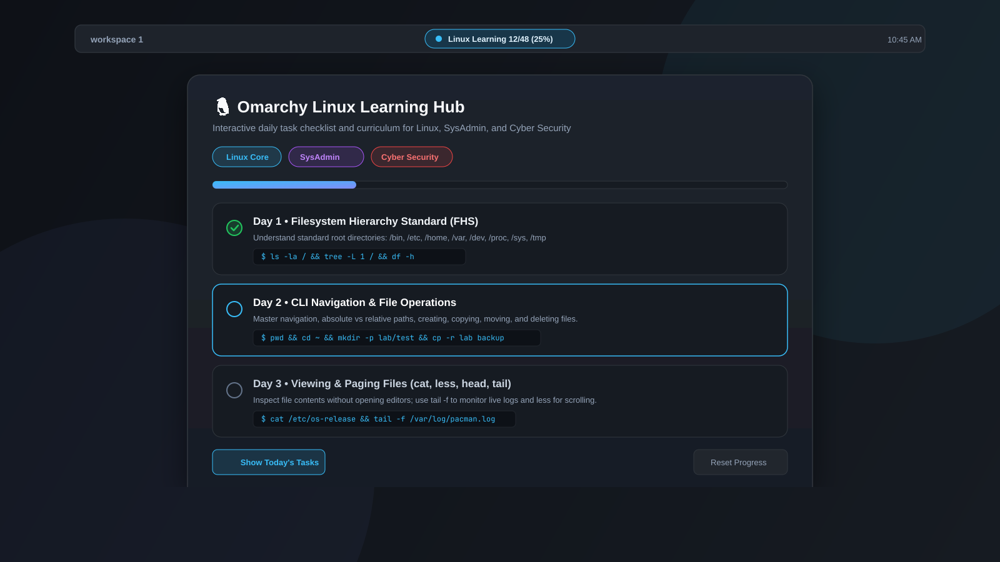

# 🐧 Omarchy Linux Learning Hub

An interactive learning and daily task tracking bar widget designed for **Omarchy Linux** and **Quickshell**, featuring an embedded interactive lab runner, automated task verification, and a full-featured CLI companion.



---

## 🌟 What's New in v2.0.0

- 📚 **Dual Curriculum Tracks**:
  - **48-Day Intensive Track**: Core Linux fundamentals, SysAdmin, and Cyber Security hardening.
  - **90-Day Full DevOps & Cyber Roadmap**: 6 comprehensive phases (Foundations, Scripting, SysAdmin, Networking, Hardening, and Forensics/Incident Response).
  - Switch anytime from the UI header pill or CLI.
-  **1-Click Terminal Practice Labs**:
  - Hit **`Run`** (or press `r`) on any topic to instantly launch an interactive practice session in your terminal (`foot`) with pre-staged commands, colorful headers, and an active shell.
-  **Automated Verification ("Check My Work")**:
  - Non-destructive automated tests (`verify-task.sh` or the UI `Verify` button) check real system configuration and auto-complete verified tasks!
- 💡 **Interactive Syntax Breakdown**:
  - Click **`Syntax Breakdown`** to view an explainer of what each flag and argument does (e.g. `tar -czvf`, `grep -rnE`, `chmod 755`).
- ⌨ **Keyboard-First Navigation**:
  - Seamlessly navigate tasks with `j` / `k` (or arrow keys), toggle completion with `Space`, run in terminal with `r`, copy command with `c`, run verification with `v`, toggle syntax with `e`, and jump to search with `/`.
- 🛠️ **CLI Companion (`omarchy-learn`)**:
  - Full CLI management: `omarchy-learn status`, `today`, `list`, `show <day>`, `run <day>`, `verify <day>`, `done <day>`, `mode <48|90>`, and `export`.
- 📋 **One-Click Markdown Journey Export**:
  - Generate a complete GitHub-ready `MY_LINUX_JOURNEY.md` summary with progress percentages, streak records, badges, and completed checklists.
- 🔔 **Daily Desktop Reminder**:
  - Automated desktop notifications to maintain study habits and protect streaks.
- 🔄 **Customizable Top Bar Styles**:
  - Right-click the bar button to toggle between Minimal (` 15%`), Streak Focus (`🔥 3d •  15%`), and Detailed (` 7/48 (15%)`).

---

## 📂 Project Directory Structure

```
omarchy-linux-learning-hub/
├── bin/
│   ├── omarchy-learn     # Full-featured CLI companion tool
│   ├── run-lab.sh        # Interactive terminal lab launcher
│   ├── verify-task.sh    # Automated non-destructive task verification runner
│   └── notify-daily.sh   # Desktop notification reminder script
├── data/
│   ├── roadmap48.json    # 48-Day Intensive Track curriculum definition
│   └── roadmap90.json    # 90-Day Full Roadmap curriculum definition
├── scripts/
│   └── build_curriculum.py # Curriculum compiler and bundler
├── Curriculum.js         # Fast synchronous QML curriculum engine & badges
├── Panel.qml             # Quickshell UI widget and bar button logic
├── manifest.json         # Omarchy plugin manifest and metadata
├── preview.png           # Marketplace preview image
├── README.md             # Project documentation
└── LICENSE               # MIT License
```

---

## 🚀 Installation

### 1. Clone into your Omarchy plugins directory

```bash
git clone https://github.com/omara256/omarchy-linux-learning-hub.git ~/.config/omarchy/plugins/learn.linux
```

### 2. Enable in Omarchy Shell

Add `learn.linux` to your status bar layout in `~/.config/omarchy/shell.json` (e.g., in `centerBegin`):

```json
{
  "bar": {
    "layout": {
      "centerBegin": [
        "learn.linux"
      ]
    }
  }
}
```

Then reload Omarchy Shell:
```bash
omarchy restart shell
```

### 3. (Optional) Set Up CLI Companion in your PATH

Symlink the CLI tool to `~/.local/bin` so you can use `omarchy-learn` anywhere:

```bash
mkdir -p ~/.local/bin
ln -sf ~/.config/omarchy/plugins/learn.linux/bin/omarchy-learn ~/.local/bin/omarchy-learn
```

---

## 💻 CLI Companion Usage

```bash
# View overview, streak, and progress bars
omarchy-learn status

# View today's 4 daily focus tasks
omarchy-learn today

# Inspect full details and syntax breakdown of a topic (by day or ID)
omarchy-learn show 1

# Launch interactive terminal practice lab
omarchy-learn run 1

# Run automated verification check on system state
omarchy-learn verify 1

# Mark task complete or pending
omarchy-learn done 1
omarchy-learn undone 1

# Switch curriculum (48-Day Intensive or 90-Day Full Roadmap)
omarchy-learn mode 90
omarchy-learn mode 48

# Export markdown progress summary
omarchy-learn export ~/Documents/MY_LINUX_JOURNEY.md

# Trigger daily notification reminder
omarchy-learn notify
```

---

## ⌨️ Keyboard Shortcuts (Inside Panel)

| Shortcut | Action |
| :---: | :--- |
| **`j` / `k`** or **`↓` / `↑`** | Move selection between topics |
| **`Space`** | Toggle completion of selected task |
| **`r`** or **`Enter`** | Run practice command in interactive terminal lab |
| **`c`** | Copy primary command to clipboard (`wl-copy`) |
| **`v`** | Run automated verification check |
| **`e`** | Toggle syntax breakdown & flags explainer |
| **`x`** | Expand/collapse sub-steps and commands |
| **`/`** | Focus search input field |
| **`Escape`** | Exit search focus or close panel |

---

## 🗑️ Uninstallation

1. Remove `learn.linux` from `~/.config/omarchy/shell.json`.
2. Delete the plugin folder:
   ```bash
   rm -rf ~/.config/omarchy/plugins/learn.linux
   ```
3. Remove CLI symlink:
   ```bash
   rm -f ~/.local/bin/omarchy-learn
   ```
4. *(Optional)* Remove saved progress data:
   ```bash
   rm -rf ~/.config/omarchy/linux-learning
   ```
5. Reload shell:
   ```bash
   omarchy restart shell
   ```

---

## 📄 License

MIT © [Omara Augustine](https://github.com/omara256)
